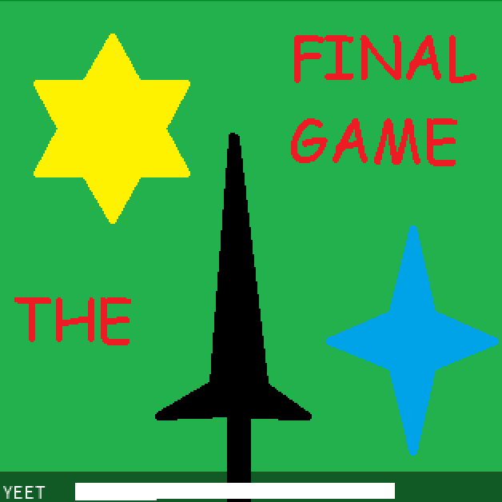
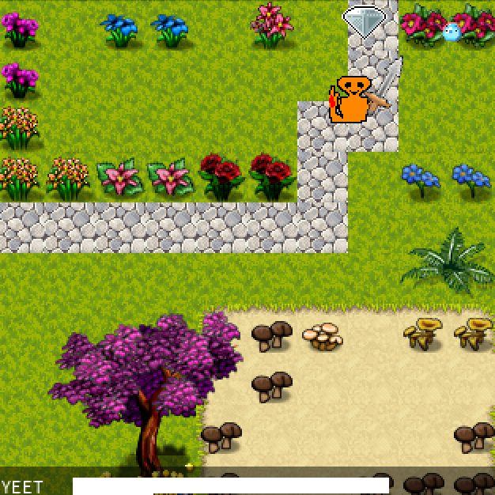
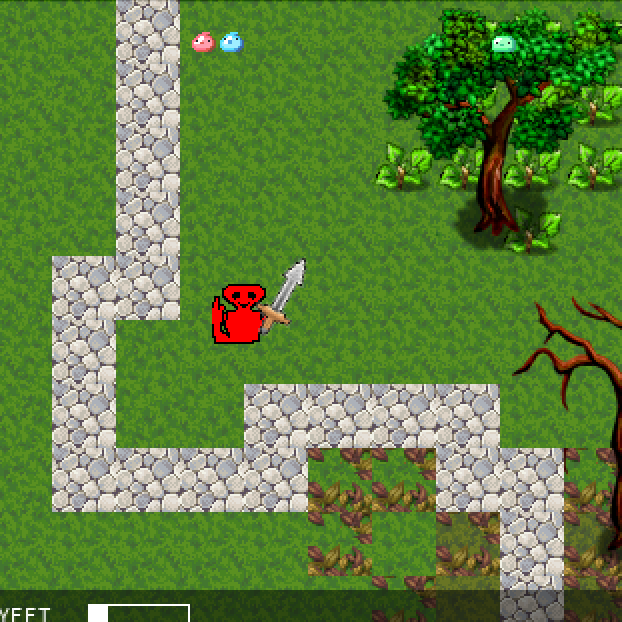
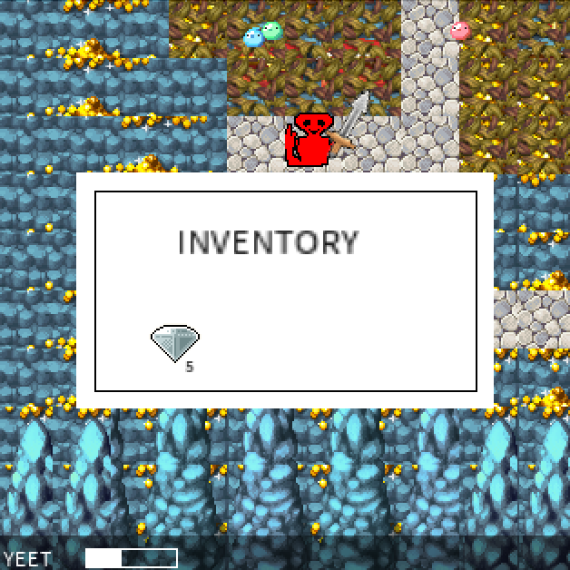
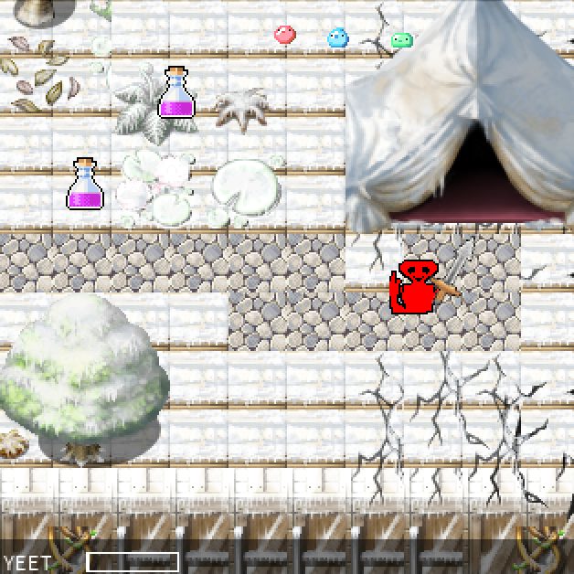
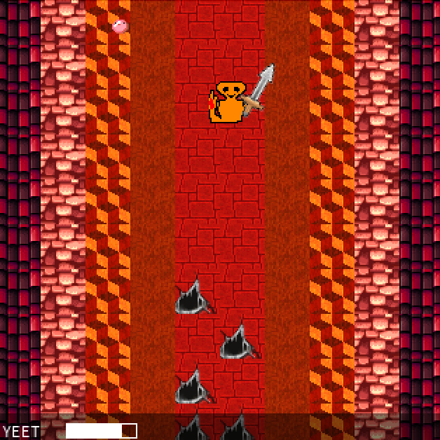
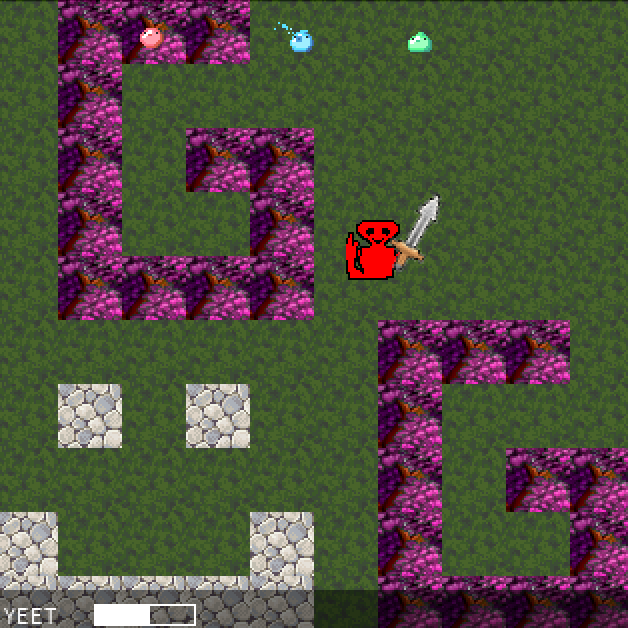
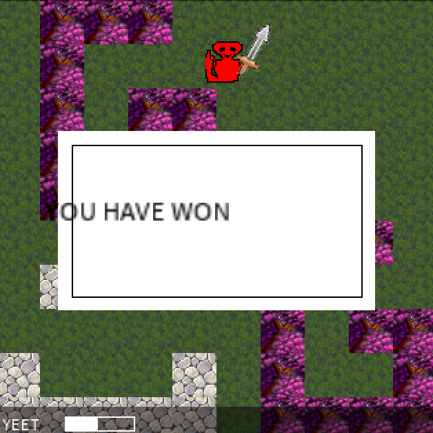
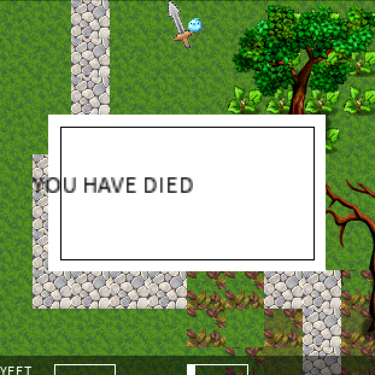

# NCMNS VisLab Summer Camp 2019

Games I made in [Processing](https://processing.org) (Java) at the NC Museum of Natural Sciences VisLab summer coding camp in 2019, recovered from my old USB backup.

## THE FINAL GAME

A top-down adventure game. You play as a Charmander with a sword, fighting slimes across six rooms. Defeat every slime in a room and collect its diamond to move on to the next one. Pick up pink potions and Poké Balls to heal, and beat every slime in the last room to win.

### Screenshots

<table>
  <tr>
    <td></td>
    <td></td>
    <td></td>
  </tr>
  <tr>
    <td align="center">Start screen</td>
    <td align="center">Room 1: a slime drops a diamond</td>
    <td align="center">Room 2</td>
  </tr>
  <tr>
    <td></td>
    <td></td>
    <td></td>
  </tr>
  <tr>
    <td align="center">Inventory in the crystal cave</td>
    <td align="center">Snowy room with potions</td>
    <td align="center">Lava hallway</td>
  </tr>
  <tr>
    <td></td>
    <td></td>
    <td></td>
  </tr>
  <tr>
    <td align="center">The final room</td>
    <td align="center">Winning</td>
    <td align="center">...and dying</td>
  </tr>
</table>

### Controls

| Key | Action |
| --- | --- |
| `Y` | Start the game |
| Arrow keys | Move |
| `Control` | Swing your sword |
| `I` | Open or close your inventory |

### How to run it

1. Install [Processing 4](https://processing.org/download).
2. In Processing, go to **Sketch → Import Library → Manage Libraries…** and install these two libraries:
   - **Sound** (by the Processing Foundation)
   - **Sprites** (by Peter Lager)
3. Open `THE_FINAL_GAME/THE_FINAL_GAME.pde` and press **Run** (▶).

### Two versions

| Folder | What it is |
| --- | --- |
| `THE_FINAL_GAME/` | **Fixed version.** Cleaned up so it runs and plays properly. |
| `original-2019/THE_FINAL_GAME/` | **Original version.** The 2019 code exactly as I wrote it, bugs and all: the invisible walls, the slimes drifting into the corner, and the capital `Y` bug that keeps idle slimes at the top. The only change is that the accidental duplicate `- Copy` tabs were left out so it runs. The images and sounds are the untouched originals. |

To play the original, open `original-2019/THE_FINAL_GAME/THE_FINAL_GAME.pde` instead.

### What was fixed in 2026

The original backup wouldn't run, so the fixed version has these changes:

- **Removed duplicate tabs.** The sketch folder had a `- Copy.pde` duplicate of every tab. Processing compiles all tabs together, so every function and class was defined twice and the sketch failed with dozens of "already defined" errors.
- **Fixed a slime movement bug.** In `monster.pde`, `y = constrain(Y + moveY, …)` used a capital `Y`. Processing has a built-in constant called `Y` (equal to 1), so idle slimes kept snapping to the top of the screen. It's now a lowercase `y`.
- **Removed invisible walls in the first room.** Walls come from the collision image `data/smallplantsyes.png`, where any solid pixel blocks you. Besides the flowers, tree and mushrooms, it also had stray squares of grass and sand painted into it. Those blended in with the ground, so they acted as invisible walls and boxed in both you and the slimes. Those filler squares were removed, so now only the actual plants block you.
- **Stopped slimes from drifting into the corner.** Their random wandering used `random(-0.1, 0.3)`, which leans toward right and down, so every slime slowly slid into the bottom-right corner and stayed there. It's now an even `random(-0.3, 0.3)`.
- **Fixed folder name capitalization.** `Data` is now `data`, and the slime sprite path now uses `sprites/Characters` to match the actual folder name. This keeps the game working on computers whose files are case-sensitive.
- **Trimmed the assets.** Only the images and sounds the game actually uses are included. The original backup also had about 1.5 GB of unused music, sprite packs, older versions of the game and Windows installers.

## Earth_Dodger

My first warm-up sketch from the camp. You move a blue planet around with `W` `A` `S` `D` and "eat" a yellow square that jumps to a new spot every time you catch it.

---

Cleaned up and documented with Claude (Opus 5.5) by Anthropic.
